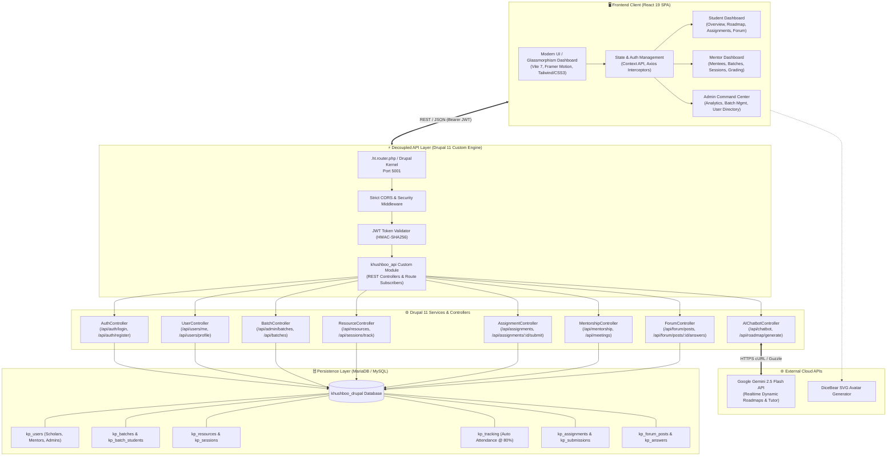

<div align="center">

# 🎓 Khushboo Pathshala
### **Next-Gen Decoupled Digital Learning & Engagement Platform**
*Empowering Cybage Khushboo Scholarship scholars through modern decoupled web architecture, AI-driven learning roadmaps, and real-time mentorship.*

[](https://react.dev/)
[](https://www.drupal.org/)
[](https://www.php.net/)
[](https://mariadb.org/)
[](https://ai.google.dev/)
[](https://jwt.io/)

</div>

---

## 📋 Executive Overview

**Khushboo Pathshala** is an enterprise-grade digital learning platform custom-engineered for the **Cybage Khushboo Scholarship Program**. 

The platform has been completely re-architected from legacy monolithic setups into a modern **Decoupled Headless Drupal 11 + React 19** application. It features automated video attendance tracking, 1-on-1 mentorship sessions, cohort-based resource distribution, discussion forums, and native integration with **Google Gemini 2.5 Flash AI** for dynamic personalized curriculum roadmaps and a 24/7 AI tutor chatbot.

---

## 🏛️ System Architecture



---

## 🛠️ Technology Stack Breakdown

| Layer | Technology | Version | Purpose |
|---|---|---|---|
| **Frontend Framework** | **React** | `v19.0.0` | Next-gen declarative UI with modern hooks and fast reconciliation |
| **Bundler & Tooling** | **Vite** | `v7.3.1` | Instant HMR development and optimized production ES modules |
| **Styling & Motion** | **CSS3 + Framer Motion** | `v12.4.7` | Glassmorphism, dark/light themes, fluid micro-interactions |
| **Icons & Typography** | **React Icons & Lucide** | Latest | Outfit / Inter font system, consistent modern icon badges |
| **Backend CMS** | **Drupal Core** | `v11.x` | Decoupled headless content architecture with custom REST modules |
| **PHP Runtime** | **PHP** | `v8.2+ / v8.3+` | Built-in CLI web server, PDO MySQL, cURL, JSON, OpenSSL |
| **Custom Module** | **`khushboo_api`** | `v1.0` | Enterprise routing, parameter validation, and secure SQL queries |
| **Database** | **MariaDB / MySQL** | `10.4+ / 8.0+` | Normalized transactional schema (`kp_*`) with utf8mb4 collation |
| **AI Engine** | **Google Gemini** | `2.5 Flash` | Zero-shot learning roadmaps, real-time responses, doubt resolution |
| **Authentication** | **Stateless JWT** | `HMAC-SHA256` | Secure bearer token auth with automatic Axios interceptor refresh |

---

## ⚡ Office VDI & Local Setup Guide

The repository is configured to run out-of-the-box on corporate Office VDIs and local developer machines with zero friction.

### 1️⃣ Prerequisites
- **XAMPP / MariaDB**: Apache & MySQL (port `3306`).
- **PHP 8.2+**: Available in system `PATH` with `pdo_mysql`, `curl`, and `openssl` enabled.
- **Node.js 18+ & npm**: For running the React 19 client.

---

### 2️⃣ Database Setup (One-Time)
1. Start MySQL in your XAMPP Control Panel (or via command line).
2. Create the `khushboo_drupal` database and import the included production dump:

```bash
# Using MySQL Command Line or PowerShell:
mysql -u root -e "CREATE DATABASE IF NOT EXISTS khushboo_drupal DEFAULT CHARACTER SET utf8mb4 COLLATE utf8mb4_unicode_ci;"
mysql -u root khushboo_drupal < khushboo_drupal.sql
```
*(Alternatively, open `http://localhost/phpmyadmin`, create `khushboo_drupal`, and click **Import** -> choose `khushboo_drupal.sql`)*

---

### 3️⃣ 1-Click Launch (Recommended for Demos)
Simply double-click:
```bat
start-all.bat
```
This launcher automatically:
- Checks if MySQL is running and starts it if needed.
- Launches the Drupal 11 PHP Backend on **`http://127.0.0.1:5001`**.
- Launches the React 19 Frontend Vite dev server on **`http://localhost:5173`**.

---

### 4️⃣ Manual Terminal Launch (Optional)

#### Backend (Drupal 11):
```bat
cd drupal-backend\web
php -S 0.0.0.0:5001 .ht.router.php
```
*Health check:* [`http://127.0.0.1:5001/api/health`](http://127.0.0.1:5001/api/health)

#### Frontend (React 19):
```bash
cd client
npm install
npm run dev
```
*Web application:* [`http://localhost:5173`](http://localhost:5173)

---

## 🔐 Verified Demo Credentials

All test accounts are pre-seeded in `khushboo_drupal.sql`:

| Role | Email | Password | Access Scope |
|---|---|---|---|
| **Admin** | `admin@cybage.com` | `password123` | Full administrative control, batch allocation, user roles, analytics |
| **Mentor** | `rakesh.sinha@cybage.com` | `password123` | Mentee review, video uploads, session scheduler, assignment grading |
| **Mentor** | `priya.sharma@cybage.com` | `password123` | Alternate mentor with distinct assigned batches |
| **Student** | `anita.sharma@example.com` | `password123` | Full-Stack cohort scholar with live attendance, assignments, and roadmaps |
| **Student** | `prasad.wadkar@example.com` | `password123` | Dedicated student account with full interactive history |

---

## 🌟 Core Feature Modules

### 👨‍🎓 1. Student Dashboard & Experience
- **Overview & Activity Heatmap**: Real-time stats reflecting actual video completion, assignments, and GitHub-style daily activity heatmap.
- **AI Learning Roadmap**: Generates structured, day-by-day learning schedules with milestone tracking via Google Gemini 2.5 Flash API.
- **Smart Auto-Attendance**: Automatically logs verified attendance in `kp_tracking` when a student watches 80% or more of an assigned session video.
- **Assignments & Grading**: View due dates, submit GitHub/Drive links with notes, and receive immediate mentor feedback and letter grades.
- **1-on-1 Mentorship**: Request and view scheduled mentorship video meetings with dedicated Google Meet links.
- **Q&A Forum**: Ask technical questions, upvote high-quality answers, and collaborate across cohorts.
- **AI Learning Assistant (Chatbot)**: Floating interactive AI companion to answer curriculum questions and debug code in real time.

### 👨‍🏫 2. Mentor Management Hub
- **Mentee Tracking**: Filter and view enrolled students by batch, track individual attendance percentages, and monitor learning velocity.
- **Session & Resource Uploader**: Publish YouTube lectures and downloadable study guides directly to specific batches.
- **Assignment Reviewer & Grader**: Review student submissions with file/link inspection and assign grades with rich feedback comments.
- **Live Meeting Scheduler**: Create 1-on-1 or batch-wide video sessions with calendar sync and automatic student alerts.

### 🔐 3. Admin Command Center
- **Executive Analytics**: Global platform metrics including active students, completion rates, batch distribution charts, and engagement trends.
- **Batch Management**: Create cohorts, assign designated faculty mentors, and allocate enrolled scholars.
- **User Directory**: Searchable directory with instant role management (`STUDENT`, `MENTOR`, `ADMIN`) and account status toggles.
- **Announcements**: Publish broadcast notices or batch-specific alerts with markdown support.

---

## 📡 REST API Reference

The Drupal 11 custom module exposes clean, uniform JSON endpoints adhering to standard HTTP verbs:

### 🔑 Authentication & Users
| Method | Endpoint | Description | Auth Required |
|---|---|---|---|
| `POST` | `/api/auth/login` | Authenticate user & return JWT token | No |
| `POST` | `/api/auth/register` | Register student account | No |
| `GET` | `/api/users/me` | Fetch authenticated profile & batch info | Yes |
| `PUT` | `/api/users/profile` | Update profile avatar, bio, and social links | Yes |
| `GET` | `/api/users/dashboard` | Role-specific dynamic dashboard telemetry | Yes |

### 📚 Learning Resources & Tracking
| Method | Endpoint | Description | Auth Required |
|---|---|---|---|
| `GET` | `/api/resources` | Fetch batch-filtered videos and documents | Yes |
| `POST` | `/api/resources` | Upload video session or resource (Mentor/Admin) | Yes |
| `POST` | `/api/sessions/track` | Track watch progress & auto-mark attendance at 80% | Yes |

### 📝 Assignments & Submissions
| Method | Endpoint | Description | Auth Required |
|---|---|---|---|
| `GET` | `/api/assignments` | Retrieve assignments for current user/batch | Yes |
| `POST` | `/api/assignments` | Create new assignment (Mentor/Admin) | Yes |
| `POST` | `/api/assignments/{id}/submit` | Submit student assignment solution | Yes |
| `PUT` | `/api/assignments/{id}/grade` | Grade submission and leave mentor feedback | Yes |

### 🤝 Mentorship & Meetings
| Method | Endpoint | Description | Auth Required |
|---|---|---|---|
| `GET` | `/api/mentorship` | Get assigned mentor/mentees & program data | Yes |
| `GET` | `/api/mentorship/meetings` | List scheduled mentorship meetings | Yes |
| `POST` | `/api/mentorship/meetings` | Schedule new meeting with Google Meet link | Yes |

### 💬 Forum & AI Tutor
| Method | Endpoint | Description | Auth Required |
|---|---|---|---|
| `GET` | `/api/forum/posts` | Retrieve community forum threads | Yes |
| `POST` | `/api/forum/posts` | Create new question with category tags | Yes |
| `POST` | `/api/forum/posts/{id}/answers` | Post answer to an existing discussion thread | Yes |
| `POST` | `/api/chatbot` | Google Gemini 2.5 Flash query endpoint | Yes |
| `POST` | `/api/roadmap/generate` | Generate AI-powered personalized curriculum | Yes |

---

## 📁 Repository Directory Structure

```
Khushboo-Pathshala/
├── client/                               # React 19 Frontend SPA (Vite)
│   ├── public/                           # Static assets & logos
│   ├── src/
│   │   ├── api/                          # Axios instance, interceptors, and sync
│   │   ├── components/                   # Reusable UI widgets, ChatBot, Navbars
│   │   │   ├── admin/                    # Batch & User Management modals
│   │   │   ├── layout/                   # StudentLayout, MentorLayout, AdminLayout
│   │   │   └── student/                  # Student sub-components
│   │   ├── context/                      # AuthContext & global state
│   │   ├── pages/
│   │   │   ├── admin/                    # Admin Dashboard & Analytics
│   │   │   ├── auth/                     # Login & Profile pages
│   │   │   ├── mentor/                   # Mentor Dashboard & sub-pages
│   │   │   └── student/                  # Student Overview, Roadmap, Forum, etc.
│   │   ├── App.jsx                       # Root application routing
│   │   └── main.jsx                      # React entrypoint
│   └── package.json                      # React 19 dependencies & Vite scripts
│
├── drupal-backend/                       # Decoupled Drupal 11 PHP Backend
│   ├── vendor/                           # Pre-packaged Composer dependencies
│   └── web/
│       ├── core/                         # Drupal 11 Core framework
│       ├── modules/custom/khushboo_api/  # Custom REST API module & controllers
│       ├── sites/default/settings.php    # Pre-configured MariaDB database settings
│       ├── .ht.router.php                # PHP built-in server router
│       └── index.php                     # Drupal entrypoint
│
├── khushboo_drupal.sql                   # Complete database dump with test seed data
├── start-all.bat                         # 1-Click Complete Stack Launcher
├── start-backend.bat                     # Dedicated Drupal Backend Launcher
├── start-frontend.bat                    # Dedicated React Frontend Launcher
├── Technology_Specification.pdf          # Cybage Khushboo Project Specifications
├── .gitignore                            # Clean repository ignore configuration
└── README.md                             # Platform documentation
```

---

## 🏆 Demonstration Walkthrough (For Reviewers)

When showcasing this application to your team:
1. **Launch Stack**: Run `start-all.bat`.
2. **Student Flow**:
   - Log in with `anita.sharma@example.com` (`password123`).
   - Navigate to **Overview**: Demonstrate real-time statistics and activity heatmap.
   - Navigate to **Roadmap**: Click **Generate AI Roadmap** to trigger the Gemini 2.5 Flash integration.
   - Test **Chatbot**: Open the floating tutor in the bottom-right corner and ask a curriculum question.
   - Navigate to **Courses**: Play a lecture video to demonstrate the real-time progress and auto-attendance.
3. **Mentor Flow**:
   - Log out and log in with `rakesh.sinha@cybage.com` (`password123`).
   - Navigate to **Mentees**: View enrolled students and their attendance velocity.
   - Navigate to **Assignments**: Review student submissions and submit grades.
4. **Admin Flow**:
   - Log out and log in with `admin@cybage.com` (`password123`).
   - View high-level metrics, manage student batches, and explore system users.

---

<div align="center">

**Developed with ❤️ for the Cybage Khushboo Scholarship Program**  
*Decoupled Drupal 11 • React 19 • Google Gemini AI • MariaDB*

</div>
